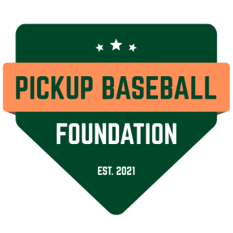

#  Pickup Baseball Foundation (`www.pickupbaseballfoundation.org`)

A fast, durable, and zero-cost web application built for the **[Pickup Baseball Foundation](https://www.pickupbaseballfoundation.org)** to organize free weekly Sunday pickup baseball games at Noon.

Designed with a **10+ year longevity philosophy**:
- **Zero Frontend Build Steps**: Pure HTML5, semantic CSS3, and standard Vanilla JavaScript (`public/`). No bundlers, Webpack, Vite, or framework churn that breaks over time.
- **100% Free-Tier Serverless Edge Stack**: Hosted on **Cloudflare Pages** (static assets + global CDN), **Cloudflare Pages Functions / Workers** (`functions/api/[[route]].js` powered by Hono), **Cloudflare D1** (serverless SQLite in the cloud), and **Resend** (transactional email).
- **Passwordless Email Authentication**: Players sign in with a 6-digit verification code or 1-click magic link sent to their email (SHA-256 hashed in D1, 10-minute expiration, 5-attempt lockout, and 90-day `HttpOnly; Secure; SameSite=Lax` session cookies).
- **Defense-in-Depth Security**: Parameterized D1 prepared statements, server-side + Cloudflare WAF rate limiting, CSRF `Origin` checks, strict CSP/HSTS headers (`public/_headers`), automatic client- and server-side EXIF/GPS metadata stripping on profile photos, and configurable guest access controls.
- **Progressive Web App (PWA) & Offline Shell**: Installable on Android, iOS, and Desktop with offline app shell caching, `{ ignoreSearch: true }` cache matching, and instant `0ms` stale-while-revalidate local caching.
- **15 California Languages & RTL Support**: Zero-dependency internationalization supporting English, Spanish, Chinese, Tagalog, Vietnamese, Korean, Arabic, Russian, Persian/Farsi, Japanese, Punjabi, Armenian, Portuguese, Hindi, and French with dynamic right-to-left layout support.
- **12 MLB Market Color Themes**: Comprehensive theme system featuring 12 Major League Baseball team palettes, an inline footer theme picker beside the foundation motto, and rigorous contrast-ratio tuning.

---

## 🌟 Key Features

1. **Compact Sunday Game Calendar & Schedule Export**:
   - High-density, space-efficient Sunday Game Calendar mounted prominently at the top of the homepage (`public/index.html`) above the game feed.
   - Designed specifically for weekly pickup baseball: eliminates the 6/7ths empty Monday–Saturday space of traditional 30-day grids, focusing 100% of the viewable area on Sunday game days (reducing vertical footprint by ~75%).
   - Month-by-month navigation (prev/next month, today jump), localized Pacific Time (`America/Los_Angeles`) day alignment, and visual game indicators (player counts, rainout pills, attending status, and today highlight).
   - Interactive date drawer showing full game info, location, attendance, duty coverage, and direct RSVP links.
   - Quick **1-Click `.ics` Export Download** (`pickup-baseball-schedule.ics`) compatible with Apple Calendar, Microsoft Outlook, and Google Calendar, plus direct 1-click **Add to Google Calendar** links for every game.
   - Fast-scroll anchor links (`📅 Calendar` in the top navigation bar and `📅 Game Calendar ↓` in the hero banner).

2. **Game Scheduling & Roster Tracking**:
   - Live player roster showing confirmed headcount, player bios, and shared equipment.
   - Instant RSVP confirmation email with game details and a personal management link.
   - 1-Click **"Post Next Sunday @ Noon"** scheduler normalized to `America/Los_Angeles` (Pacific Time).
   - Inline **Edit Game Details** tool for organizers and facilitators with smart location autocomplete.

3. **Volunteer Duty Coordination & Game Day Roles**:
   - Customizable default task template pre-configured with the 6 essential game-day duties:
     - **Game Facilitator** (1 slot) — *Help coordinate teams, batting order, and fair play throughout the game.*
     - **Water / Food** (1 slot) — *Bring drinking water, ice, and dugout snacks or fruit for players.*
     - **Bases** (1 slot) — *Bring 3 throw-down bases.*
     - **Pitching machine and power** (1 slot) — *Bring a pitching machine and a way to run it on the field.*
     - **Game Baseballs** (1 slot) — *Bring game balls bucket.*
     - **Field Dragging** (2 slots) — *Arrive 20 mins early to drag the infield with the pull rake.*
   - Real-time slot availability, duty progress bar, and volunteer attribution (`✓ Covered by [Name]`).

4. **Equipment Sharing & Game Discussion Board**:
   - Players list what gear they can bring (bats, catcher's gear, spare gloves) and coordinate field conditions or carpools on the per-game discussion board.

5. **Roster Capacity, Waitlist & Player Privacy**:
   - Automated roster capacity capping (`max_players`) with instant waitlist activation.
   - Automatic queue promotion upon cancellations with instant email dispatch.
   - Multi-guest reservation support (+1 to +5 guests per RSVP).
   - **Privacy Shield for Player Rosters**: Unauthenticated visitors see a privacy notice protecting player identities until an RSVP is submitted or an organizer signs in.
   - Dedicated **[Past Games Archive](https://www.pickupbaseballfoundation.org/archive.html)** with Sunday turnout recording.

6. **Weather & Rainout Incident Broadcasts**:
   - 1-Click **"🌧️ Call Rainout"** workflow with custom field conditions and makeup notes.
   - Automated cancellation email blast via Resend to all confirmed attendees and volunteers, explicitly releasing gear and duty commitments.
   - Prominent sky-blue rainout banner and 1-click **"☀️ Reopen Game"** tool if fields dry up.

7. **12 Major League Baseball Color Themes & Light/Dark Mode**:
   - Integrated theme trigger located in the page footer alongside the organization motto (*"Building community through America's pastime."*).
   - 12 authentic team market palettes with adaptive hero gradient banners:
     1. **Bay Area Heritage** (SF Giants Orange `#FD5A1E` & Oakland A's Forest Green `#003831`)
     2. **Seattle Mariners** (Northwest Green `#005C5C` & Navy `#0C2340`)
     3. **Chicago White Sox** (South Side Black `#27251F`, Slate `#334155`, & Silver `#94a3b8`)
     4. **Milwaukee Brewers** (Harvest Gold `#B6891A` & Glove Navy `#12284C`)
     5. **Los Angeles Dodgers** (Dodger Blue `#005A9C` & Silver `#0B2341`)
     6. **New York Yankees** (Pinstripe Navy `#1E3A5F` & Silver `#0C2340`)
     7. **Boston Red Sox** (Fenway Crimson `#C8102E` & Navy `#0C2340`)
     8. **Chicago Cubs** (Wrigley Royal `#0E3386` & Cubbie Red `#CC3433`)
     9. **Baltimore Orioles** (Camden Orange `#DF4601` & Black `#212322`)
     10. **San Diego Padres** (Friar Brown `#2F241D` & Sungold `#C48200`)
     11. **Arizona Diamondbacks** (Sedona Red `#A71930` & Desert Teal `#26696D`)
     12. **Classic 1980s Retro** (Powder Blue `#0284c7` & Royal Navy `#004687`)
   - High-contrast accessibility tuning: White Sox dark mode button contrast at **12.5:1**; Fenway Crimson dark mode contrast at **4.60:1** (eliminating washed-out salmon/pastel tones); uniform light-colored selection cards across all 12 teams in dark mode.
   - Home-plate shield logo (`/logo.svg`) preserves designed colors in all modes without CSS inversion filters.

8. **15 California Languages & RTL Support**:
   - Zero-dependency client-side translation engine in `public/js/api.js` powered by lightweight JSON dictionaries (`public/i18n/*.json`).
   - Supports English (`en`), Spanish (`es`), Chinese Simplified (`zh`), Tagalog (`tl`), Vietnamese (`vi`), Korean (`ko`), Arabic (`ar`), Russian (`ru`), Persian/Farsi (`fa`), Japanese (`ja`), Punjabi (`pa`), Armenian (`hy`), Portuguese (`pt`), Hindi (`hi`), and French (`fr`).
   - Automatic browser locale detection, `Intl.DateTimeFormat` date localization, compact navbar selector, and dynamic `dir="rtl"` layout flipping for Arabic and Persian.

9. **Progressive Web App (PWA) & Offline Shell**:
   - Web App Manifest (`manifest.webmanifest`) supporting standalone display mode, responsive icons, and transparent 1:1 home-screen badges.
   - Offline Service Worker (`public/sw.js`) serving static app shell assets instantly offline.
   - Instant `0ms` stale-while-revalidate local caching (`localStorage`) for schedules and user profiles.
   - **Smart Conditional Update Button (`✨ Update Available`):** Kept completely invisible (`display: none`) when the app is up to date, eliminating all visual clutter. Powered by a dual-detection engine: (1) every API response transmits an `X-App-Version` HTTP header compared against the client's version, and (2) Service Worker `waiting` and `updatefound` listeners monitor background downloads. When a discrepancy or new edge build is detected, the button smoothly fades in beneath the theme picker with a pulsing badge. Clicking purges stale caches, triggers `SKIP_WAITING`, and reloads into the fresh version, immediately restoring the button to its invisible state.

10. **Reverse Compatibility & Low-Bandwidth Optimizations**:
   - Pure ES6-compatible JavaScript without modern syntax dependencies (no optional chaining or unpolyfilled APIs).
   - Dual CSS Logical & Physical property fallbacks (`margin-inline-start` + `margin-left`, `border-inline-start` + `border-left`) and flex child margin fallbacks.
   - **99.99% JSON payload reduction** (`25.07 MB` → `2.9 KB`) via dedicated cached avatar endpoint (`GET /api/users/:id/avatar?v=...`) with automated 256×256 compression and EXIF metadata stripping.
   - Collapsed network waterfalls: single batched D1 database round-trip per page load.
   - Enforced 16px minimum font size on form inputs to prevent iOS Mobile Safari auto-zooming.

11. **Donations & Plain-Language Privacy Promise**:
    - Dedicated **[Donate page](https://www.pickupbaseballfoundation.org/donate.html)** with PayPal Giving Fund, Every.org, and IRS tax-receipt instructions.
    - Plain-English privacy notice on the homepage explaining that only names and emails are collected and data is never shared or sold.

12. **Four-Tier RBAC, Facilitator Role, & Database Backups**:
    - Role-based access control with 4 distinct tiers: `Admin`, `Organizer`, `Facilitator`, and `Player`.
    - Dedicated **Game Facilitator** role (`📋 Game Facilitator`) with event creation, editing, and rainout management privileges.
    - One-click **📥 Backup Database (.sql)** download directly from the Admin Dashboard.
    - User account removal, email ban list (`banned_emails`), guest RSVP policy toggle, and one-click roster/comment moderation.

13. **Detailed Development Narrative & Open Source**:
    - Complete chronicle of all architectural decisions, edge migrations, and technical phases in **[`DEVELOPMENT_NARRATIVE.md`](DEVELOPMENT_NARRATIVE.md)**.
    - Direct GitHub repository link in the site footer beside *"Free & open-source"*.

---

## 🏗️ Project Structure

```text
├── public/                     # Static frontend served by Cloudflare Pages CDN
│   ├── index.html              # Homepage, hero schedule, & privacy promise
│   ├── event.html              # Game details, RSVP form, duty board, & discussion
│   ├── archive.html            # Past games archive & historic turnout records
│   ├── login.html              # Passwordless email sign-in / registration
│   ├── profile.html            # Player profile, bio, & avatar uploader
│   ├── admin.html              # Organizer & Admin dashboard
│   ├── donate.html             # Charity donation options & IRS receipt notice
│   ├── 404.html                # Custom 404 page
│   ├── manifest.webmanifest    # PWA installable web app manifest
│   ├── sw.js                   # Service Worker for offline shell caching
│   ├── _headers                # Cloudflare Pages security headers (CSP, HSTS, etc.)
│   ├── _redirects              # Enforces canonical custom domain over *.pages.dev
│   ├── _routes.json            # Routes /api/* and /health to Cloudflare Pages Functions
│   ├── css/style.css           # Core stylesheet with 12 MLB market color palettes
│   ├── i18n/                   # Translation dictionaries (15 languages: en, es, zh, tl, vi, ko, ar, ru, fa, ja, pa, hy, pt, hi, fr)
│   ├── icons/                  # Favicons and PWA application icons
│   ├── js/                     # Vanilla JS modules
│   │   ├── api.js              # REST client, i18n engine, themes, & auth
│   │   ├── app.js              # Homepage schedules & game listing
│   │   ├── event.js            # Game roster, duty board, & discussion logic
│   │   ├── archive.js          # Past games listing & turnout recording
│   │   ├── admin.js            # Admin dashboard logic & database backups
│   │   └── account-dashboard.js# Organizer panels & role-based dashboard views
│   └── logo.svg                # Vector home-plate shield logo
├── functions/
│   ├── api/[[route]].js        # Hono REST API running on Cloudflare Pages Functions / Workers
│   └── health.js               # Health check endpoint (/health)
├── scripts/
├── DEVELOPMENT_NARRATIVE.md    # Comprehensive chronicle of all development phases
├── d1_schema.sql               # Cloudflare D1 SQLite database schema (DDL + default duties)
└── wrangler.toml               # Cloudflare Pages, environment vars, & D1 binding configuration
```

---

## 🛠️ Step-by-Step Setup Guide (From Scratch)

You can run this entire stack **100% free** using a free **[Cloudflare](https://dash.cloudflare.com)** account and a free **[Resend](https://resend.com)** account.

### Prerequisites
1. Install **[Node.js](https://nodejs.org/)** (v18+ or v22 LTS).
2. Clone the repository and install dependencies (`hono` and `wrangler`):
   ```bash
   git clone https://github.com/djrow/pickup-baseball.git
   cd pickup-baseball
   npm install
   ```
3. Authenticate the Cloudflare Wrangler CLI with your Cloudflare account:
   ```bash
   npx wrangler login
   ```

---

### Step 1: Set Up Cloudflare D1 (Serverless SQLite Database)

Cloudflare D1 provides a serverless SQLite database at the edge (free tier includes 5 GB storage and 5 million rows read/day).

1. **Create the D1 database**:
   ```bash
   npx wrangler d1 create pickup-baseball-db --location=wnam
   ```
   *(Valid locations include `wnam` for Western North America, `enam` for Eastern North America, `weur` for Western Europe, etc.)*

2. **Copy the `database_id` into `wrangler.toml`**:
   Update the `[[d1_databases]]` section of `wrangler.toml` with the `database_id` returned by the command above:
   ```toml
   [[d1_databases]]
   binding = "DB"
   database_name = "pickup-baseball-db"
   database_id = "YOUR-DATABASE-ID-HERE"
   ```

3. **Initialize the database schema (Remote & Local)**:
   Apply `d1_schema.sql` to create all tables (`users`, `sessions`, `auth_codes`, `events`, `event_duties`, `attendees`, `duty_assignments`, `comments`, `default_duties`, `banned_emails`, `app_settings`, `rate_limits`) and seed the 4 default duties:
   ```bash
   # Apply to the live remote D1 database in Cloudflare:
   npx wrangler d1 execute pickup-baseball-db --remote --file=d1_schema.sql

   # Apply to your local development D1 database:
   npx wrangler d1 execute pickup-baseball-db --local --file=d1_schema.sql
   ```

---

### Step 2: Configure Environment Variables (`wrangler.toml`)

In `wrangler.toml`, configure your organization's public variables under `[vars]`:

```toml
name = "pickup-baseball"
compatibility_date = "2024-10-22"
compatibility_flags = ["nodejs_compat"]
pages_build_output_dir = "public"

[vars]
APP_NAME = "Sunday Pickup Baseball"
FROM_EMAIL = "Sunday Pickup Baseball <games@pickupbaseballfoundation.org>"
REPLY_TO_EMAIL = "pickupbaseballfoundation@gmail.com"
ADMIN_EMAIL = "pickupbaseballfoundation@gmail.com"
ADMIN_NAME = "David Rowland"
```
> **Admin Auto-Assignment**: When the user matching `ADMIN_EMAIL` signs in via email code or magic link for the first time, their account is automatically granted the `admin` role. All other self-registered accounts are strictly assigned the `player` role.

---

### Step 3: Set Up Resend (Transactional Email)

Resend's free tier provides **3,000 emails/month** (100/day) over HTTPS REST API, used for sending 6-digit login codes, magic links, and RSVP confirmations.

1. **Create a Resend Account & Verify Your Domain**:
   - Sign up at **[resend.com](https://resend.com)** → go to **Domains** → **Add Domain** (e.g., `pickupbaseballfoundation.org`).
   - Add the DNS records Resend provides (`send` CNAME/MX for Return-Path and `resend._domainkey` TXT for DKIM) to your Cloudflare DNS settings.
2. **Generate an API Key**:
   - In Resend, go to **API Keys** → **Create API Key** and copy the key (starts with `re_...`).
3. **For Local Development (`.dev.vars`)**:
   - Create a `.dev.vars` file in the project root (ignored by Git):
     ```ini
     RESEND_API_KEY=re_your_api_key_here
     ```
   - *(If `RESEND_API_KEY` is omitted locally, sign-in codes and magic links are printed to the terminal console instead.)*

---

### Step 4: Set Up Cloudflare Pages & Pages Functions / Workers

Cloudflare Pages hosts both the static files in `public/` and the serverless Hono API in `functions/api/[[route]].js`.

- **How the Worker Routing Works**:
  - `public/_routes.json` instructs Cloudflare Pages to serve all static HTML/CSS/JS files directly from the CDN edge (0 Worker invocations) and only invoke the Pages Function Worker for `/api/*` and `/health`.
  - The Cloudflare Pages Functions edge API is maintained directly in `functions/api/[[route]].js` with zero duplicate wrapper scripts.

1. **Create the Cloudflare Pages Project**:
   ```bash
   npx wrangler pages project create pickup-baseball --production-branch trunk
   ```

2. **Save Your `RESEND_API_KEY` as an Encrypted Cloudflare Secret**:
   ```bash
   npx wrangler pages secret put RESEND_API_KEY --project-name pickup-baseball
   ```
   *(Paste your `re_...` key when prompted. This encrypts and attaches the secret to your production Worker without ever storing it in `wrangler.toml` or Git.)*

3. **Deploy to Cloudflare Pages**:
   ```bash
   npm run deploy
   ```
   *(This runs `npx wrangler pages deploy public --project-name pickup-baseball --branch trunk --commit-dirty=true`, bundling `functions/` automatically and reading the D1 binding from `wrangler.toml`.)*

---

### Step 5: Connect Your Custom Domain & Harden Cloudflare Edge

1. **Attach Custom Domain to Pages**:
   - In **Cloudflare Dashboard → Workers & Pages → `pickup-baseball` → Custom domains**, click **Set up a custom domain** and add both `www.pickupbaseballfoundation.org` and `pickupbaseballfoundation.org`.
2. **DNS Records (`Cloudflare Dashboard → DNS → Records`)**:
   - `CNAME` `www` → `pickup-baseball.pages.dev` (*Proxied / Orange cloud*)
   - `CNAME` `@` → `pickup-baseball.pages.dev` (*Proxied / Orange cloud*)
   - `CNAME` `send` → `send.forge.rmta.net` (*DNS only / Grey cloud* — for Resend)
   - `TXT` `resend._domainkey` → *(Your Resend DKIM public key)*
   - `TXT` `_dmarc` → `v=DMARC1; p=quarantine; rua=mailto:pickupbaseballfoundation@gmail.com`
   - `TXT` `@` → `v=spf1 include:_spf.google.com include:amazonses.com ~all`
3. **Edge Bot & WAF Protection (`Cloudflare Dashboard → Security`)**:
   - **Security → Bots**: Enable **Bot Fight Mode**.
   - **Security → WAF → Rate limiting rules**: Create a rule matching `URI Path equals /api/auth/send-code` → block for `10 seconds` when rate exceeds `5 requests per 10 seconds`.

---

## 💻 Local Development Commands

```bash
# Start local Cloudflare Pages + D1 dev server at http://localhost:8788
npm run dev


# Deploy static assets and Worker functions to production
npm run deploy
```

---

## 💾 Database Backups

Signed-in administrators can download a complete `.sql` backup of the live Cloudflare D1 database at any time by clicking **📥 Backup Database (.sql)** on the **[Admin Dashboard](https://www.pickupbaseballfoundation.org/admin.html)** (`/api/events/admin/backup-db`).

*(Note: `.db` and `.sql` backup files are excluded via `.gitignore` so player email addresses are never committed to Git.)*

---

## 📜 License
MIT License. Built for the Pickup Baseball Foundation.
