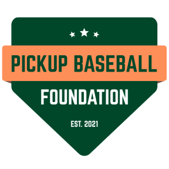

#  Pickup Baseball Foundation (`www.pickupbaseballfoundation.org`)

A fast, durable, and zero-cost web application built for the **[Pickup Baseball Foundation](https://www.pickupbaseballfoundation.org)** to organize free weekly Sunday pickup baseball games at Noon.

> 📘 **User Guide & Manual Maintenance Handbook:** Read **[`HANDBOOK.md`](HANDBOOK.md)** for a complete walkthrough of how to use the web app (players, spectators, volunteers, organizers, and admins) plus step-by-step recipes for making manual changes to the code yourself.

Designed with a **10+ year longevity philosophy**:
- **Zero Frontend Build Steps**: Pure HTML5, semantic CSS3, and standard Vanilla ES6 JavaScript (`public/`). No bundlers, Webpack, Vite, or framework churn that breaks over time.
- **100% Free-Tier Serverless Edge & Dual Local Runtime**: Unified **Hono** API (`src/app/`) running identically on **Cloudflare Pages Functions** (`functions/api/[[route]].js`) + **Dual Cloudflare D1** databases (`BASEBALL_DB` + `CHAT_DB`) and local **Node.js + Express 5 + `better-sqlite3`** (`src/server.js`, `src/d1-sqlite.js`), with **Resend** (transactional email) and optional **Google Drive** storage pooling (`src/app/gdrive.js`) for heavy gallery photos/videos, chat attachments, and GIF imports.
- **Passwordless Email Authentication**: Players sign in with a 6-digit verification code or 1-click magic link sent to their email (SHA-256 hashed in D1, 10-minute expiration, 5-attempt lockout, per-user active session cap of 5, optional 4-hour temporary shared-device sessions, and *"Sign out all other devices"*).
- **Defense-in-Depth Security**: Parameterized D1 prepared statements, server-side + Cloudflare WAF rate limiting, Cloudflare Turnstile verification, `Origin`/`Referer`/`Sec-Fetch-Site` CSRF checks, strict CSP/HSTS headers (`public/_headers`), DNS/IPv4/IPv6 SSRF guards, client- and server-side EXIF/GPS metadata stripping on raster uploads, Web Crypto ECDH P-256 + AES-GCM-256 E2EE for Clubhouse DMs/private boards, and a 12-check static/live security scanner (`npm run security:scan`).
- **Progressive Web App (PWA) & Offline Shell**: Installable on Android, iOS, and Desktop with offline app shell caching, `{ ignoreSearch: true }` cache matching, instant `0ms` stale-while-revalidate local caching, and a footer app version badge (`#footer-app-version`, currently `v143`).
- **15 California Languages & RTL Support**: Zero-dependency internationalization supporting English, Spanish, Chinese, Tagalog, Vietnamese, Korean, Arabic, Russian, Persian/Farsi, Japanese, Punjabi, Armenian, Portuguese, Hindi, and French with dynamic right-to-left layout support (303 keys per bundle).
- **12 MLB Market Color Themes**: Comprehensive theme system featuring 12 Major League Baseball team palettes, an inline footer theme picker beside the foundation motto, and rigorous contrast-ratio tuning.

---

## 🌟 Key Features

1. **Rolling 5-Week Sunday Game Calendar & Interactive Schedule**:
   - High-density, space-efficient Sunday Game Calendar mounted prominently as the primary schedule on the homepage (`public/index.html`).
   - **Continuous Rolling Event Horizon**: Replaces rigid 30-day month boundaries with a dynamic rolling track:
     - **Card 1: Contextual Past Event**: Displays the most recent past game (or previous Sunday) featuring a `📜 Past Game` badge and turnout recap (`👥 X Turnout`), opening a recap drawer with direct links to comments and the archive.
     - **Card 2: Anchored Next Game**: Highlights the upcoming game with a prominent `⚾ Next Game` badge strictly anchored to the real-world timeline (`trueNextGameKey`).
     - **Cards 3–6: Upcoming & Prospective Dates**: Displays subsequent scheduled games or prospective Sundays tagged with `📅 Prospective` and `📍 TBA (Unscheduled)`.
   - **Dynamic Month Range Header & Multi-Week Step**: Dynamically formats visible month boundaries (e.g. `Oct – Nov 2026`) and steps forward/backward by 4 weeks with `‹` / `›` controls and a 1-click `Today` reset.
   - **Non-Sunday Event Support**: Mid-week games, clinics, or Saturday tournaments automatically slot into chronological order with custom weekday tags (`Sat, Nov 7`).
   - **Interactive Preview Drawer**: Selecting any game slides open `#calendar-date-drawer` with Google Calendar export, location map, volunteer task status, and 1-click RSVP.
   - **Live Cloud Sync Status Pill & Auto-Refresh**: Displays a real-time sync badge (`🟢 Cloud synced • Just now ↻`) next to the calendar subtitle that flips to an amber warning (`⚠️ Offline — cached schedule (...) ↻`) whenever the device is offline or unreachable, and automatically re-syncs with Cloudflare D1 when returning to the browser tab/PWA (`visibilitychange`), regaining signal (`online`), or tapping the pill.
   - **Live Cloud Calendar Subscription (`webcal://` & `/api/events/calendar.ics`)**: 1-click live subscription panel for **Apple Calendar**, **Google Calendar**, and **Microsoft Outlook** (with 1-hour refresh headers, automatic rainout prefixes `🌧️ RAINED OUT:`, and zero player PII), alongside a 1-click static `.ics` snapshot download and direct access to the **[Past Games Archive](https://www.pickupbaseballfoundation.org/archive.html)**.

2. **Simplified Group RSVPs (Players, Spectators & Off-Field Volunteers), Roster Tracking, & RSVP Whitelists**:
   - **Single-Step Group RSVP**: A single account or email can RSVP for an entire household or friend group using two mutually-exclusive headcount steppers — **⚾ Players** *(playing on the field, `0..25`)* and **👏 Spectators** *(watching or helping off-field, `0..25`)* — alongside a unified **🛡️ Group Volunteer Tasks** checklist.
   - **Spectator & Off-Field Volunteer Support**: Only on-field `players_count` consumes `max_players` playing roster capacity. Spectators and off-field volunteers (`0 Players`) never take player spots and confirm immediately even when the playing roster is full.
   - **Group-Owned Task Responsibility**: Checked volunteer tasks are owned by the group/account as a whole (`🛡️ Group Tasks`), eliminating per-person task friction while tucking optional group names and shared gear into a clean collapsible `<details>` drawer.
   - Live **"👥 Who's Coming"** roster displaying confirmed player and spectator badges, off-field volunteer tags (`🙌 Volunteer`), shared equipment, and group task assignments.
   - Instant RSVP confirmation email with group breakdown and a personal management link.
   - 1-Click **"Post Next Sunday @ Noon"** scheduler normalized to `America/Los_Angeles` (Pacific Time).
   - Inline **Edit Game Details** tool for organizers and facilitators with smart location autocomplete.
   - **Per-Event RSVP Whitelists (Allowed Player Emails)**: Event creators (Admins and Organizers) can designate private or invitational games restricted to specific player email addresses. Built with an Organizer candidate accounts search directory (`GET /api/events/attendee-candidates`) featuring checkbox multi-selection and custom email entry, enforced with HTTP 403 Forbidden on unauthorized signups and polite invitation status notices on the event page.

3. **Unified Group Volunteer Task Coordination**:
   - Single unified **🛡️ Group Volunteer Tasks** checklist integrated directly inside the RSVP card (retiring the duplicate standalone Task Board card for a cleaner, scannable event page, and switching automatically to a read-only view when RSVPs are locked or rained out).
   - Customizable default task template pre-configured with the 6 essential game-day tasks:
     - **Game Facilitator** (1 slot) — *Help coordinate teams, batting order, and fair play throughout the game.*
     - **Water / Food** (1 slot) — *Bring drinking water, ice, and dugout snacks or fruit for players.*
     - **Bases** (1 slot) — *Bring 3 throw-down bases.*
     - **Pitching machine and power** (1 slot) — *Bring a pitching machine and a way to run it on the field.*
     - **Game Baseballs** (1 slot) — *Bring game balls bucket.*
     - **Field Dragging** (2 slots) — *Arrive 20 mins early to drag the infield with the pull rake.*
   - Real-time slot availability, task progress bar, and volunteer attribution (`✓ Covered by [Name]`).

4. **Equipment Sharing & Game Discussion Board**:
   - Players list what gear they can bring (bats, catcher's gear, spare gloves) and coordinate field conditions or carpools on the per-game discussion board.

5. **Streamlined Calendar-First Homepage & Roster Privacy**:
   - Pure calendar-first landing page: retired redundant lower featured game cards and secondary lists in favor of the unified rolling calendar and slide-out preview drawer.
   - Automated playing roster capacity capping (`max_players`) with instant waitlist activation for on-field players while allowing spectators to join freely.
   - Automatic queue promotion upon cancellations or on-field player reductions with instant email dispatch.
   - Group reservation support (`0..25` players and `0..25` spectators per account).
   - **Privacy Shield for Player Rosters**: Unauthenticated visitors see a privacy notice protecting player identities until an RSVP is submitted or an organizer signs in.
   - Dedicated **[Past Games Archive](https://www.pickupbaseballfoundation.org/archive.html)** with Sunday turnout recording.

6. **Smart Rainout Assistant, 10-Day Forecast & Rainout Broadcasts**:
   - **Zero-Host Client Weather Engine (`public/js/weather.js`):** Queries Open-Meteo directly from the browser for a **10-day forecast** (temperature & emoji pills per game card resolved to each diamond's location), a **5-day rainfall breakdown**, and a **24-hour surface drainage simulation** ($\tau = 8.0\text{h}$ soil decay) classifying fields from 🟢 Playable to 🔴 Waterlogged.
   - 1-Click **"🌧️ Call Rainout"** workflow with custom field conditions and makeup notes.
   - Automated cancellation email blast via Resend to all confirmed attendees and volunteers, explicitly releasing gear and task commitments.
   - Prominent sky-blue rainout banner and 1-click **"☀️ Reopen Game"** tool if fields dry up.

7. **12 Major League Baseball Color Themes & Light/Dark Mode**:
   - Integrated theme trigger located in the page footer alongside the organization motto (*"Building community through America's pastime."*).
   - 12 authentic team market palettes with adaptive hero gradient banners:
     1. **Bay Area Heritage** (SF Giants Orange `#FD5A1E` & Oakland A's Forest Green `#003831`)
     2. **Seattle Mariners** (Northwest Green `#005C5C` & Navy `#0C2340`)
     3. **Chicago White Sox** (South Side Black `#27251F`, Slate `#334155`, & Silver `#94a3b8`)
     4. **Milwaukee Brewers** (Harvest Gold `#B6891A` & Glove Navy `#12284C`)
     5. **Los Angeles Dodgers** (Dodger Blue `#005A9C` & Silver `#0B2341`)
     6. **New York Yankees** (Pinstripe Navy `#1E3A5F` & Silver `#0C2340`)
     7. **Boston Red Sox** (Fenway Crimson `#C8102E` & Navy `#0C2340`)
     8. **Chicago Cubs** (Wrigley Royal `#0E3386` & Cubbie Red `#CC3433`)
     9. **Baltimore Orioles** (Camden Orange `#DF4601` & Black `#212322`)
     10. **San Diego Padres** (Friar Brown `#2F241D` & Sungold `#C48200`)
     11. **Arizona Diamondbacks** (Sedona Red `#A71930` & Desert Teal `#26696D`)
     12. **Classic 1980s Retro** (Powder Blue `#0284c7` & Royal Navy `#004687`)
   - High-contrast accessibility tuning: White Sox dark mode button contrast at **12.5:1**; Fenway Crimson dark mode contrast at **4.60:1** (eliminating washed-out salmon/pastel tones); uniform light-colored selection cards across all 12 teams in dark mode.
   - Home-plate shield logo (`/logo.svg`) preserves designed colors in all modes without CSS inversion filters.

8. **15 California Languages & RTL Support**:
   - Zero-dependency client-side translation engine in `public/js/api.js` powered by lightweight JSON dictionaries (`public/i18n/*.json`).
   - Supports English (`en`), Spanish (`es`), Chinese Simplified (`zh`), Tagalog (`tl`), Vietnamese (`vi`), Korean (`ko`), Arabic (`ar`), Russian (`ru`), Persian/Farsi (`fa`), Japanese (`ja`), Punjabi (`pa`), Armenian (`hy`), Portuguese (`pt`), Hindi (`hi`), and French (`fr`).
   - Automatic browser locale detection, `Intl.DateTimeFormat` date localization, compact navbar selector, and dynamic `dir="rtl"` layout flipping for Arabic and Persian.

9. **Progressive Web App (PWA) & Offline Shell**:
   - Web App Manifest (`manifest.webmanifest`) supporting standalone display mode, responsive icons, and transparent 1:1 home-screen badges.
   - Offline Service Worker (`public/sw.js`) serving static app shell assets instantly offline.
   - Instant `0ms` stale-while-revalidate local caching (`localStorage`) for schedules and user profiles.
   - **Smart Conditional Update Button (`✨ Update Available`):** Kept completely invisible (`display: none`) when the app is up to date, eliminating all visual clutter. Powered by a dual-detection engine: (1) every API response transmits an `X-App-Version` HTTP header compared against the client's version, and (2) Service Worker `waiting` and `updatefound` listeners monitor background downloads. When a discrepancy or new edge build is detected, the button smoothly fades in beneath the theme picker with a pulsing badge. Clicking purges stale caches, triggers `SKIP_WAITING`, and reloads into the fresh version, immediately restoring the button to its invisible state.

10. **Reverse Compatibility & Low-Bandwidth Optimizations**:
   - Pure ES6-compatible JavaScript without modern syntax dependencies (no optional chaining or unpolyfilled APIs).
   - Dual CSS Logical & Physical property fallbacks (`margin-inline-start` + `margin-left`, `border-inline-start` + `border-left`) and flex child margin fallbacks.
   - **99.99% JSON payload reduction** (`25.07 MB` → `2.9 KB`) via dedicated cached avatar endpoint (`GET /api/users/:id/avatar?v=...`) with automated 256×256 compression and EXIF metadata stripping.
   - Collapsed network waterfalls: single batched D1 database round-trip per page load.
   - Enforced 16px minimum font size on form inputs to prevent iOS Mobile Safari auto-zooming.

11. **Donations & Plain-Language Privacy Promise**:
    - Dedicated **[Donate page](https://www.pickupbaseballfoundation.org/donate.html)** with PayPal Giving Fund, Every.org, and IRS tax-receipt instructions.
    - Plain-English privacy notice on the homepage explaining that only names and emails are collected and data is never shared or sold.

12. **Three-Tier RBAC, Turnout Recording & Database Backups**:
    - Role-based access control with 3 distinct tiers: `Admin`, `Organizer`, and `Player`.
    - **Organizer** role (`🛡️ Organizer`) with full game creation, inline task management, rainout emergency alerts, and field turnout recording privileges (`actual_attendance`) across game, admin, and archive pages.
    - One-click **📥 Backup Database (.sql)** download directly from the Admin Dashboard.
    - User account removal, email ban list (`banned_emails`), guest RSVP policy toggle, and one-click roster/comment moderation.

13. **223-Test Acceptance Suite & Automated Security Scanner**:
    - 223 automated end-to-end tests launched via `npm test` (`scripts/verify-all.js` + `tests/core/*.test.js` + `tests/clubhouse/tier1–5`) using native Node.js test runner (`node:test`, `node:assert/strict`) with zero third-party test dependencies.
    - 12-check automated security & parity scanner (`npm run security:scan` and `npm run security:scan:live` via `scripts/security-scan.js`) validating HTML CSP compliance, `_headers`, client ES6 syntax & sinks, SQL parameterization, mutating route auth guards, `SECURITY.md` / `security.txt`, secret hygiene, `npm audit`, 33-asset PWA parity, and 333-key i18n parity across all 14 language bundles, plus a zero-dependency headless Chrome/Edge CDP browser smoke suite (`npm run test:browser`).

14. **RSS 2.0 & Media RSS Feed with Zero-Host Multimedia Interpretation**:
    - Standard **RSS 2.0 + Media RSS** feed endpoint (`/feed.xml` and `/api/feed.xml`) equipped with autodiscovery `<link rel="alternate" type="application/rss+xml" href="/feed.xml">` and RFC 822 timestamps.
    - **Zero Cloudflare Media Storage Overhead**: Organizers and admins post game recaps, video clips, and photo albums without hosting heavy media files on Cloudflare. The database stores only external URLs, titles, and text while multimedia streams directly from external platforms.
    - **Rich In-App Interpretation & Display**:
      - **YouTube videos & shorts**: Translated into responsive 16:9 privacy-preserving embeds (`youtube-nocookie.com`) with automated video ID resolution.
      - **Photos & Albums**: Rendered as responsive lazy-loaded photo cards with RSS `<enclosure>` and `<media:content>` tags.
      - **Video & Audio**: Rendered with native HTML5 `<video controls playsinline>` and `<audio controls>`.
    - Real-time live multimedia preview and post management on `public/admin.html`.

15. **Clubhouse Chat, E2EE Messaging & WebRTC Voice Dugout (`public/clubhouse.html`)**:
    - Dedicated dual-database (`CHAT_DB`) community hub with `#announcements`, `#general`, per-game `#game-*` synced channels, private encrypted boards, and Direct Messages (DMs) using Web Crypto ECDH P-256 + AES-GCM-256 (`public/js/crypto.js`) and DM Safety Numbers.
    - Low-overhead adaptive delta sync (`4s` active / `8s` idle in `public/js/store.js`), Google Drive-backed GIFs & file attachments (`/api/gifs`, `/api/attachments`), WebRTC voice room signaling (`public/js/rtc.js`, `/api/voice`, `/api/rtc`), opt-in privacy lifecycle, and moderator/mute controls (`is_moderator`).

16. **Community Photo & Video Gallery (`public/gallery.html`), Digital Waivers (`public/waiver.html`) & About Us (`public/about.html`)**:
    - **Photo, Video & Art Gallery (`gallery.html`):** Community gallery with Google Drive resumable upload pooling, moderation approval queue, and integrated Community Art Studio canvases (Pixel Diamond, Dugout Wall, Chalkboard).
    - **Digital Liability Waiver (`waiver.html`):** ESIGN/UETA-compliant digital & paper waiver signing with SHA-256 provenance-sealed certificates.
    - **Streamlined `☰ Menu`, `About Us` & Footer Version (`v143`):** Unified header `☰ Menu` dropdown linking to Clubhouse, Gallery & Art, About Us (`public/about.html`), Donate, and Admin; footer displays live loaded version (`#footer-app-version`) alongside live security posture badges (`SSL Labs A+`, `HTTP Observatory A+`, `Security Headers A+`, `CodeQL & Policy`, `security.txt`).

17. **User & Maintenance Handbook, Development Narrative, & Open Source**:
    - Practical guide to using every feature and making manual code edits in **[`HANDBOOK.md`](HANDBOOK.md)**, complete chronological history in **[`DEVELOPMENT_NARRATIVE.md`](DEVELOPMENT_NARRATIVE.md)**, and coordinated disclosure policy in **[`SECURITY.md`](SECURITY.md)**.
    - Direct GitHub repository link and loaded version badge in the site footer.

---

## 🏗️ Project Structure

```text
├── public/                        # Static frontend served by Cloudflare Pages CDN
│   ├── index.html                 # Homepage, Sunday schedule calendar, & privacy promise
│   ├── event.html                 # Game details, Group RSVP, tasks, BP, weather, & discussion
│   ├── clubhouse.html             # Clubhouse realtime chat, E2EE DMs/boards & voice rooms
│   ├── gallery.html               # Community photo, video & art gallery (Drive-backed)
│   ├── art.html                   # Legacy Community Art Studio path (relocates to gallery.html)
│   ├── archive.html               # Past games archive & historic turnout records
│   ├── waiver.html                # Digital liability waiver & cryptographic certificates
│   ├── about.html                 # Organization mission & quick links
│   ├── donate.html                # Charity donation options & IRS receipt notice
│   ├── login.html                 # Passwordless email sign-in / registration
│   ├── profile.html               # Player profile, bio, avatar uploader, & session controls
│   ├── admin.html                 # Organizer & Admin dashboard (users, security, tasks, DB backups)
│   ├── 404.html                   # Custom 404 page
│   ├── .well-known/security.txt   # RFC 9116 vulnerability disclosure metadata
│   ├── manifest.webmanifest       # PWA installable web app manifest
│   ├── sw.js                      # Service Worker for offline shell caching (v143)
│   ├── _headers                   # Cloudflare Pages security headers (CSP, HSTS, etc.)
│   ├── _redirects                 # Enforces canonical custom domain over *.pages.dev & /handbook
│   ├── _routes.json               # Routes /api/*, /feed.xml, and /health to Pages Functions
│   ├── css/                       # Stylesheets (style.css, themes.css, clubhouse.css)
│   ├── gifs/                      # Starter baseball GIF catalog & assets
│   ├── i18n/                      # Translation dictionaries (14 non-English languages)
│   ├── icons/                     # Favicons and PWA application icons
│   ├── js/                        # Vanilla ES6 JS modules (api.js, weather.js, clubhouse.js,
│   │                              #   crypto.js, store.js, rtc.js, event.js, gallery.js,
│   │                              #   admin.js, app.js, archive.js, art.js, login.js,
│   │                              #   profile.js, waiver.js, nav-init.js)
│   └── logo.svg                   # Vector home-plate shield logo
├── src/
│   ├── app/                       # Unified ES-module Hono API (shared by Pages & Node)
│   │   ├── index.js               # Security headers, CSRF, WAF, session middleware & router mounts
│   │   ├── security.js            # Sessions, RBAC, rate limits, SSRF & metadata helpers
│   │   ├── schema.js              # Dual-D1 DDL, migrations & default tasks/channels
│   │   ├── gdrive.js              # Google Drive OAuth2 upload & byte-range streaming pool
│   │   ├── mailer.js              # Resend transactional email dispatch
│   │   ├── feeds.js / policy.js / version.js
│   │   └── routes/                # auth, baseball, gifs, keys, media, posts, rtc, waiver,
│   │                              #   events/{core,rsvps,bp-duties,helpers},
│   │                              #   chat/{sync,channels,messages,moderation,helpers}
│   ├── server.js / d1-sqlite.js / db.js / auth.js / seed.js  # Local Node + Express + SQLite runner
├── functions/                     # Thin Cloudflare Pages Functions entrypoints importing src/app/
│   ├── api/[[route]].js           # Delegates /api/* to unified Hono app
│   ├── feed.xml.js                # RSS 2.0 + Media RSS feed endpoint
│   └── health.js                  # Health check endpoint (/health)
├── tests/                         # Native node:test E2E suites (core/*, clubhouse/tier1–5, helpers/*)
├── scripts/                       # verify-all.js, security-scan.js, bump-version.js, ship.ps1, etc.
├── HANDBOOK.md                    # User guide & manual maintenance handbook
├── PROJECT.md                     # Architecture overview & milestones
├── SECURITY.md                    # Vulnerability disclosure policy & built-in controls
├── AGENTS.md                      # Codebase map & engineering invariants
├── DEVELOPMENT_NARRATIVE.md       # Chronological development narrative
├── d1_schema.sql                  # Cloudflare D1 SQLite schema snapshot
└── wrangler.toml                  # Cloudflare Pages, env vars & dual D1 bindings (`BASEBALL_DB`, `CHAT_DB`)
```

---

## 🛠️ Step-by-Step Setup Guide (From Scratch)

You can run this entire stack **100% free** using a free **[Cloudflare](https://dash.cloudflare.com)** account and a free **[Resend](https://resend.com)** account.

### Prerequisites
1. Install **[Node.js](https://nodejs.org/)** (v18+ or v22 LTS).
2. Clone the repository and install dependencies (`hono` and `wrangler`):
   ```bash
   git clone https://github.com/djrow/pickup-baseball.git
   cd pickup-baseball
   npm install
   ```
3. Authenticate the Cloudflare Wrangler CLI with your Cloudflare account:
   ```bash
   npx wrangler login
   ```

---

### Step 1: Set Up Dual Cloudflare D1 Databases (Serverless SQLite)

Cloudflare D1 provides serverless SQLite at the edge using two isolated databases (`BASEBALL_DB` with legacy `DB` alias for core schedules/users/waivers/media, and `CHAT_DB` for Clubhouse chat, E2EE keys, WebRTC voice presence, and GIF metadata).

1. **Create both D1 databases**:
   ```bash
   npx wrangler d1 create pickup-baseball-db --location=wnam
   npx wrangler d1 create pickup-chat-db --location=wnam
   ```
   *(Valid locations include `wnam` for Western North America, `enam` for Eastern North America, `weur` for Western Europe, etc.)*

2. **Copy both `database_id` values into `wrangler.toml`**:
   Update the `[[d1_databases]]` sections of `wrangler.toml` with the IDs returned above:
   ```toml
   [[d1_databases]]
   binding = "BASEBALL_DB"
   database_name = "pickup-baseball-db"
   database_id = "YOUR-BASEBALL-DATABASE-ID"

   [[d1_databases]]
   binding = "CHAT_DB"
   database_name = "pickup-chat-db"
   database_id = "YOUR-CHAT-DATABASE-ID"

   [[d1_databases]]
   binding = "DB"
   database_name = "pickup-baseball-db"
   database_id = "YOUR-BASEBALL-DATABASE-ID"
   ```

3. **Initialize the schemas (Remote & Local)**:
   Apply `d1_schema.sql` for the initial core schema, and note that `src/app/schema.js` (`ensureD1Schema` + `ensureChatD1Schema`) also applies idempotent table and column migrations automatically at runtime:
   ```bash
   # Apply base schema to the live remote D1 database in Cloudflare:
   npx wrangler d1 execute pickup-baseball-db --remote --file=d1_schema.sql

   # Apply base schema to your local development D1 database:
   npx wrangler d1 execute pickup-baseball-db --local --file=d1_schema.sql
   ```

---

### Step 2: Configure Environment Variables (`wrangler.toml`)

In `wrangler.toml`, configure your organization's public variables under `[vars]`:

```toml
name = "pickup-baseball"
compatibility_date = "2024-10-22"
compatibility_flags = ["nodejs_compat"]
pages_build_output_dir = "public"

[vars]
APP_NAME = "Sunday Pickup Baseball"
FROM_EMAIL = "Sunday Pickup Baseball <games@pickupbaseballfoundation.org>"
REPLY_TO_EMAIL = "pickupbaseballfoundation@gmail.com"
ADMIN_EMAIL = "pickupbaseballfoundation@gmail.com"
ADMIN_NAME = "David Rowland"
```
> **Admin Auto-Assignment**: When the user matching `ADMIN_EMAIL` signs in via email code or magic link for the first time, their account is automatically granted the `admin` role. All other self-registered accounts are strictly assigned the `player` role.

---

### Step 3: Set Up Resend (Transactional Email)

Resend's free tier provides **3,000 emails/month** (100/day) over HTTPS REST API, used for sending 6-digit login codes, magic links, and RSVP confirmations.

1. **Create a Resend Account & Verify Your Domain**:
   - Sign up at **[resend.com](https://resend.com)** → go to **Domains** → **Add Domain** (e.g., `pickupbaseballfoundation.org`).
   - Add the DNS records Resend provides (`send` CNAME/MX for Return-Path and `resend._domainkey` TXT for DKIM) to your Cloudflare DNS settings.
2. **Generate an API Key**:
   - In Resend, go to **API Keys** → **Create API Key** and copy the key (starts with `re_...`).
3. **For Local Development (`.dev.vars`)**:
   - Create a `.dev.vars` file in the project root (ignored by Git):
     ```ini
     RESEND_API_KEY=re_your_api_key_here
     ```
   - *(If `RESEND_API_KEY` is omitted locally, sign-in codes and magic links are printed to the terminal console instead.)*

---

### Step 4: Set Up Cloudflare Pages & Pages Functions / Workers

Cloudflare Pages hosts both the static files in `public/` and the thin serverless adapter in `functions/` that delegates to the unified Hono API in `src/app/`.

- **How the Worker Routing Works**:
  - `public/_routes.json` instructs Cloudflare Pages to serve all static HTML/CSS/JS files directly from the CDN edge (0 Worker invocations) and only invoke Pages Functions for `/api/*`, `/feed.xml`, and `/health`.
  - `functions/api/[[route]].js` imports `src/app/index.js`, so production Workers and local Node development share a single unified codebase.

1. **Create the Cloudflare Pages Project**:
   ```bash
   npx wrangler pages project create pickup-baseball --production-branch trunk
   ```

2. **Save Secrets as Encrypted Cloudflare Secrets**:
   ```bash
   npx wrangler pages secret put RESEND_API_KEY --project-name pickup-baseball
   # Optional: Turnstile secret (TURNSTILE_SECRET_KEY) and Google Drive media pool (or run `npm run setup:gdrive`)
   ```
   *(Paste your `re_...` key when prompted. This encrypts and attaches secrets to your production Worker without ever storing them in `wrangler.toml` or Git.)*

3. **Deploy to Cloudflare Pages**:
   ```bash
   npm run deploy
   ```
   *(This runs `npx wrangler pages deploy public --project-name pickup-baseball --branch trunk --commit-dirty=true`, bundling `functions/` automatically and reading the D1 binding from `wrangler.toml`.)*

---

### Step 5: Connect Your Custom Domain & Harden Cloudflare Edge

1. **Attach Custom Domain to Pages**:
   - In **Cloudflare Dashboard → Workers & Pages → `pickup-baseball` → Custom domains**, click **Set up a custom domain** and add both `www.pickupbaseballfoundation.org` and `pickupbaseballfoundation.org`.
2. **DNS Records (`Cloudflare Dashboard → DNS → Records`)**:
   - `CNAME` `www` → `pickup-baseball.pages.dev` (*Proxied / Orange cloud*)
   - `CNAME` `@` → `pickup-baseball.pages.dev` (*Proxied / Orange cloud*)
   - `CNAME` `send` → `send.forge.rmta.net` (*DNS only / Grey cloud* — for Resend)
   - `TXT` `resend._domainkey` → *(Your Resend DKIM public key)*
   - `TXT` `_dmarc` → `v=DMARC1; p=quarantine;` *(Anti-spoofing policy. Omit `rua=` unless routing daily XML telemetry to an automated DMARC analyzer)*
   - `TXT` `@` → `v=spf1 include:_spf.google.com include:amazonses.com ~all`
3. **Edge Bot & WAF Protection (`Cloudflare Dashboard → Security`)**:
   - **Security → Bots**: Enable **Bot Fight Mode**.
   - **Security → WAF → Rate limiting rules**: Create a rule matching `URI Path equals /api/auth/send-code` → block for `10 seconds` when rate exceeds `5 requests per 10 seconds`.

---

## 💻 Local Development & Release Commands

```bash
# Start local Node.js + Express + SQLite dev server at http://localhost:3000
npm run dev

# Start local Cloudflare Pages + D1 dev server at http://localhost:8788
npm run pages:dev

# Run the full 223-test automated E2E verification suite (core + Clubhouse tiers 1–5)
npm test

# Run the zero-dependency headless Chrome/Edge CDP browser smoke suite
npm run test:browser

# Run the 12-check static security, CSP, SQL, route-guard & parity scan
npm run security:scan

# Atomically bump version numbers across version.js, sw.js, api.js, and HTML ?v= tags
npm run bump

# Deploy static assets and Worker functions to production
npm run deploy

# Check live production security headers and public endpoints after deploy
npm run security:scan:live
```

*(On Windows, `.\scripts\ship.ps1` orchestrates the full release pipeline: branch guard → `npm run bump` → `npm test` → `npm run security:scan` → commit & tag → `npm run deploy` → git push → `npm run security:scan:live`.)*

---

## 💾 Database Backups

Signed-in administrators can download a `.sql` backup of the live core Cloudflare D1 database at any time by clicking **📥 Backup Database (.sql)** on the **[Admin Dashboard](https://www.pickupbaseballfoundation.org/admin.html)** (`/api/events/admin/backup-db`), or export either Cloudflare D1 database via Wrangler:

```bash
npm run d1:backup
npm run d1:backup:chat
```

*(Note: `.db`, `.sqlite*`, and `.sql` backup files are excluded via `.gitignore` so player email addresses are never committed to Git.)*

---

## 📜 Copyright & License
© 2026 Pickup Baseball Foundation.

Licensed under the **Apache License, Version 2.0 (Apache-2.0)**.
- **Permissive Open Source:** Free to use, modify, and distribute with attribution and preserved copyright notices.
- **Patent & Trademark Guardrails:** Includes an explicit patent license and prohibits using Pickup Baseball Foundation names or marks to imply endorsement.

See [`LICENSE`](LICENSE) for the full license text.

Prototyped with Google Gemini in October 2026 for simplicity and durability.
