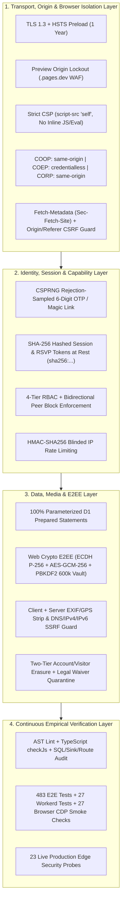

# Security Concepts & Implementation Architecture Whitepaper
**Platform:** `pickupbaseballfoundation.org` (Pickup Baseball Foundation)  
**Release Baseline:** `v154`  
**Verification Posture:** 6-Gate Zero-Build Verification Pipeline (`npm run check` + Live Edge Probes)

---

## Executive Summary

Over the past five decades—from Saltzer and Schroeder’s seminal 1975 IEEE paper *The Protection of Information in Computer Systems* to modern empirical post-mortems of web, cloud, and supply-chain breaches (Verizon DBIR, OWASP Top 10, NIST SP 800-63B, and CISA Secure by Design)—a clear empirical consensus has emerged:

1. **Complexity and transitive dependencies are the primary incubators of software vulnerabilities.**
2. **Perimeter defenses eventually fail; systems must be engineered to remain safe even if a database snapshot or network link is compromised (*breach resilience*).**
3. **Security controls that rely on developer memory fail at scale; only invariants enforced structurally by the runtime or continuously verified in CI survive production evolution.**

`pickupbaseballfoundation.org` is architected from first principles around these empirical findings. Rather than layering third-party security plugins onto a sprawling framework and bundler stack, the platform eliminates entire vulnerability classes by design: **zero frontend build step, zero third-party browser scripts, four audited production runtime packages, 100% parameterized SQL, hashed bearer credentials at rest, client-side Web Crypto end-to-end encryption (E2EE), two-tier privacy erasure, and an automated 23-point static + live edge security scanner.**

---

## 1. Economy of Mechanism & Supply-Chain Minimization

### Empirical Foundation
Saltzer & Schroeder’s first principle—**Economy of Mechanism**—states that security mechanisms must be small and simple enough to be inspected and verified completely. Modern empirical data reinforces this: in recent years, software supply-chain compromises (malicious or hijacked npm packages, bundler plugins, and transitive dependencies) and cross-site scripting via third-party CDN scripts (Magecart-style attacks) have become dominant breach vectors.

### Implementation in `pickupbaseballfoundation.org`
- **Zero-Build, Zero-Bundler Frontend:** All 36 client scripts under `public/js/` execute as native, human-readable ES6 IIFEs loaded deterministically via `<script defer src="...?v=154">`. Every line deployed to Cloudflare Pages matches the exact source file in Git—eliminating webpack/vite/babel build-time code injection and source-map obfuscation.
- **Zero Third-Party Browser Scripts (`script-src 'self'`):** The platform loads **zero** external JavaScript from CDNs, analytics trackers, font hosts, or ad networks. Subresource Integrity (SRI) risks on third-party scripts are eliminated entirely because third-party scripts cannot execute at all.
- **Minimal Runtime Dependency Tree:** [package.json](file:///C:/Users/david/documents/antigravity/lucid-maxwell/package.json#L30-L35) restricts production dependencies to **4 audited packages** (`hono`, `aws4fetch`, `express`, `better-sqlite3`). Every release runs `npm audit --omit=dev` inside [scripts/security-scan.js](file:///C:/Users/david/documents/antigravity/lucid-maxwell/scripts/security-scan.js), enforcing **0 moderate, high, or critical vulnerabilities**.
- **Lexical Encapsulation & Static Type Safety:** Every browser script is wrapped in a `'use strict'` IIFE, enforced by ESLint’s universal `no-implicit-globals: ['error', { lexicalBindings: true }]` ([eslint.config.js](file:///C:/Users/david/documents/antigravity/lucid-maxwell/eslint.config.js)) and TypeScript’s `"checkJs": true` ([tsconfig.client.json](file:///C:/Users/david/documents/antigravity/lucid-maxwell/tsconfig.client.json)), preventing global namespace collisions or DOM clobbering across modules.

---

## 2. Defense-in-Depth Against Cross-Site Scripting (XSS) & Injection

### Empirical Foundation
For over twenty years, **Injection (SQLi and XSS)** has ranked at or near the top of the OWASP Top 10. Empirical research by Google’s Information Security Engineering team (*Lukas Weichselbaum et al., CCS 2016: "CSP Is Dead, Long Live CSP"*) demonstrated that allowlist-based CSPs fail when `'unsafe-inline'` or broad CDN hosts are permitted in `script-src`, whereas strict CSPs that ban inline scripts, `eval()`, and external script hosts neutralize DOM and reflected XSS even if an HTML escaping bug occurs.

### Implementation in `pickupbaseballfoundation.org`
1. **Strict Content-Security-Policy (CSP):** Enforced identically at the Cloudflare edge ([public/_headers](file:///C:/Users/david/documents/antigravity/lucid-maxwell/public/_headers#L1-L13)), in the Hono API ([src/app/index.js](file:///C:/Users/david/documents/antigravity/lucid-maxwell/src/app/index.js#L31-L47)), and in the Node server ([src/server.js](file:///C:/Users/david/documents/antigravity/lucid-maxwell/src/server.js#L13-L27)):
   - **HTML Pages:** `default-src 'self'; script-src 'self'; object-src 'none'; frame-ancestors 'none'; base-uri 'self'; form-action 'self'; upgrade-insecure-requests;`
   - **API Responses:** `default-src 'none'; object-src 'none'; frame-ancestors 'none';`
   - **Media/Attachment Streams:** `default-src 'none'; sandbox` with `X-Content-Type-Options: nosniff`.
2. **Zero Inline Event Handlers or Dangerous Sinks:** [scripts/security-scan.js](file:///C:/Users/david/documents/antigravity/lucid-maxwell/scripts/security-scan.js#L188-L230) statically scans all 13 HTML files and 36 client JS files on every test run to guarantee zero inline `<script>` blocks, zero `on*=` attributes, zero `javascript:` URLs, zero `eval()` / `new Function()` / `document.write()` calls, and mandatory `API.escapeHtml` sanitization.
3. **Cross-Origin Process Isolation (Spectre / Side-Channel & Framing Defense):**
   - `Cross-Origin-Opener-Policy: same-origin` (isolates the browsing context group from cross-origin popups/tabs)
   - `Cross-Origin-Embedder-Policy: credentialless`
   - `Cross-Origin-Resource-Policy: same-origin`
   - `X-Frame-Options: DENY` + CSP `frame-ancestors 'none'` (eliminates Clickjacking / UI redressing)
4. **100% Parameterized SQL Queries:** Every database query across both D1 databases (`BASEBALL_DB` and `CHAT_DB`) uses `.prepare(...).bind(...)` with `?` placeholders. [scripts/security-scan.js](file:///C:/Users/david/documents/antigravity/lucid-maxwell/scripts/security-scan.js#L235-L260) parses all 63 backend files to reject any unreviewed template interpolation inside `.prepare()`.

---

## 3. Breach-Resilient Authentication & Token Cryptography

### Empirical Foundation
NIST SP 800-63B (*Digital Identity Guidelines*) and decades of credential-stuffing breaches demonstrate two critical lessons:
1. User-chosen passwords are the weakest link in authentication due to password reuse across sites.
2. **Database read compromises happen** (via leaked backups, misconfigured cloud storage, or SQL injection). Any bearer secret stored in plaintext inside a database turns a read-only backup leak into a full account-takeover catastrophe.

### Implementation in `pickupbaseballfoundation.org`

| Credential / Identifier | Generation Mechanism | Storage at Rest in D1 | Verification & Lifecycle |
| :--- | :--- | :--- | :--- |
| **6-Digit Login OTP** | CSPRNG (`crypto.getRandomValues`) with rejection sampling (`val < 4294000000`) to eliminate modulo bias ([crypto.js](file:///C:/Users/david/documents/antigravity/lucid-maxwell/src/app/security/crypto.js#L48-L57)) | `SHA-256` hex digest (`auth_codes.code`) | Constant-time comparison (`constantTimeEqual`), 10-min TTL, max 5 attempts before hard invalidation |
| **Magic Link Token** | 256-bit CSPRNG hex token ([crypto.js](file:///C:/Users/david/documents/antigravity/lucid-maxwell/src/app/security/crypto.js#L42-L46)) | `SHA-256` hex digest (`auth_codes.magic_token`) | Single-use atomic consumption, 10-min TTL |
| **Session Cookie (`baseball_session`)** | 256-bit CSPRNG hex token | `sha256:<hex>` (`sessions.id`, [session.js](file:///C:/Users/david/documents/antigravity/lucid-maxwell/src/app/security/session.js#L130-L185)) | `HttpOnly; Secure; SameSite=Lax; Path=/`; max 5 concurrent sessions per user (FIFO eviction); 4h shared-device option; 1-click *"Sign out all other devices"* |
| **Visitor RSVP Token** | 256-bit CSPRNG hex token | `sha256:<hex>` (`attendees.management_token`, [crypto.js](file:///C:/Users/david/documents/antigravity/lucid-maxwell/src/app/security/crypto.js#L115-L147)) | Always hashes caller input before constant-time comparison so a leaked `sha256:` database value cannot be replayed |
| **Calendar Feed Token (`cal_token`)** | 256-bit CSPRNG hex token | `sha256:<hex>` (`app_settings`) | Constant-time verification on `/api/events/calendar.ics` |
| **Direct Upload Token** | 256-bit CSPRNG hex token | `sha256:<hex>` (`media_items.upload_token`) | Single-use atomic consumption on `/api/media/complete` |
| **Rate-Limit Client IP** | Client IP + server secret | `HMAC-SHA256` (`hmac:<hex>`, [guards.js](file:///C:/Users/david/documents/antigravity/lucid-maxwell/src/app/security/guards.js)) | Enforces rate limits without storing raw visitor IP addresses in D1 |

> [!IMPORTANT]
> **Zero-Replay Database Post-Condition:** Even if an adversary obtained a full SQL dump of `BASEBALL_DB`, they could **not** hijack any active user session, modify any Visitor RSVP, or replay any login code or upload token, because the server unconditionally hashes incoming tokens with SHA-256 before comparing against the `sha256:<hex>` digest stored at rest.

---

## 4. Complete Mediation, RBAC & Cross-Origin Request Forgery (CSRF) Defense

### Empirical Foundation
Saltzer & Schroeder’s principle of **Complete Mediation** requires that every access to every object be checked for authority. Combined with **Least Privilege**, this prevents horizontal privilege escalation (IDOR) and Cross-Site Request Forgery (CSRF).

### Implementation in `pickupbaseballfoundation.org`
- **Multi-Layered CSRF Verification ([src/app/index.js](file:///C:/Users/david/documents/antigravity/lucid-maxwell/src/app/index.js#L121-L155)):** Every state-changing request (`POST`, `PUT`, `PATCH`, `DELETE`) is mediated at the global Hono middleware boundary before reaching any route handler:
  1. Verifies W3C Fetch Metadata (`Sec-Fetch-Site` must be `same-origin` or `none`).
  2. Verifies `Origin` header matches the exact request origin.
  3. Falls back to strict `Referer` origin validation and rejects form-encoded/multipart requests lacking both `Origin` and `Referer`.
  4. Enforces `SameSite=Lax` on the session cookie.
- **Preview Origin WAF Lockout ([src/app/index.js](file:///C:/Users/david/documents/antigravity/lucid-maxwell/src/app/index.js#L107-L119)):** Requests targeting `*.pages.dev` preview domains are automatically redirected (`GET`/`HEAD`) or rejected with `HTTP 403` (`POST`/`PUT`/`DELETE`) when `ENFORCE_CUSTOM_DOMAIN` is enabled, ensuring all traffic passes through the canonical `pickupbaseballfoundation.org` zone policies.
- **4-Tier Role-Based Access Control (RBAC) + Automated Route Auditing:**
  - Guards (`requireAuth`, `requireOrganizer`, `requireModerator`, `requireAdmin` in [src/app/security/guards.js](file:///C:/Users/david/documents/antigravity/lucid-maxwell/src/app/security/guards.js)) enforce explicit role boundaries.
  - [scripts/security-scan.js](file:///C:/Users/david/documents/antigravity/lucid-maxwell/scripts/security-scan.js) performs **both** static AST inspection and live Hono route-table introspection across all **162 routes** on every test run to guarantee no route accidentally omits its required auth/role middleware.
- **Bidirectional Peer Block Enforcement:** When Member A blocks Member B (`/api/blocks`), the server enforces bidirectional isolation across 1:1 DM creation, message sending, reactions, read watermarks, and WebRTC voice signaling (`/api/rtc/signal`), while stripping blocked peers from bootstrap and delta-sync payloads.

---

## 5. End-to-End Encryption (E2EE) & Cryptographic Key Continuity in Clubhouse

### Empirical Foundation
Modern messaging security (modeled after Signal’s X3DH/ Sesame and W3C Web Crypto standards) establishes that private group and 1:1 communications should be encrypted client-side so the hosting server and database store only authenticated ciphertext (`AES-GCM`). Furthermore, to defeat silent man-in-the-middle key substitution by a compromised server, clients must enforce **Trust On First Use (TOFU)** key pinning and out-of-band **Safety Number** verification.

### Implementation in `pickupbaseballfoundation.org` ([public/js/crypto.js](file:///C:/Users/david/documents/antigravity/lucid-maxwell/public/js/crypto.js), [public/js/store/e2ee.js](file:///C:/Users/david/documents/antigravity/lucid-maxwell/public/js/store/e2ee.js))
- **Identity & Agreement Keys:** Each opted-in Clubhouse member generates a non-extractable **ECDH P-256** keypair and **ECDSA P-256** signing keypair in the browser using native `window.crypto.subtle`.
- **Authenticated Message & Attachment Encryption:**
  - Direct messages and private boards encrypt message bodies and binary attachments client-side using **AES-GCM-256** with unique 96-bit CSPRNG initialization vectors (IVs) before upload.
  - `CHAT_DB` stores only `ciphertext`, `iv`, and `key_version`—never plaintext for E2EE channels.
- **Passphrase-Protected Key Backup Vault:**
  - Private keys are wrapped client-side using **PBKDF2-HMAC-SHA256 (600,000 iterations — OWASP 2023+ recommendation)** + **AES-GCM-256** before syncing the encrypted vault blob to `/api/keys/vault`.
- **TOFU Fingerprint Pinning, Key Rotation & Epoch Guards:**
  - Clients pin peer public key fingerprints on first contact (`localStorage` + IndexedDB) and surface a visible cryptographic audit warning if a peer’s identity key changes, alongside a 60-digit numeric **Safety Number** comparison modal ([public/js/clubhouse/e2ee-ui.js](file:///C:/Users/david/documents/antigravity/lucid-maxwell/public/js/clubhouse/e2ee-ui.js)).
  - Private board membership removal triggers automatic `key_version` epoch rotation, re-wrapping a fresh AES-256 channel key exclusively for remaining active members.

---

## 6. SSRF Prevention, Media Sanitization & Offline Zero-PII Caching

### Empirical Foundation
Empirical cloud security research shows that **Server-Side Request Forgery (SSRF)** (OWASP A10:2021) frequently compromises cloud metadata services (`169.254.169.254`), localhost ports, and internal RFC 1918 networks. Likewise, user-uploaded photos routinely leak home/field GPS coordinates via embedded EXIF metadata, and shared-device browser caches can leak personal data after a user signs out.

### Implementation in `pickupbaseballfoundation.org`
- **Strict SSRF Validation ([src/app/security/ssrf.js](file:///C:/Users/david/documents/antigravity/lucid-maxwell/src/app/security/ssrf.js)):** External GIF imports validate URLs against strict HTTPS host allowlists, block custom ports and credentials, and inspect IPv4, IPv6, IPv4-mapped IPv6 (`::ffff:`), loopback (`127.0.0.0/8`, `::1`), link-local/cloud-metadata (`169.254.0.0/16`, `fe80::/10`), Carrier-Grade NAT (`100.64.0.0/10`), and RFC 1918 ranges across every redirect hop (`redirect: 'manual'`).
- **Dual Client + Server EXIF/GPS Stripping & Magic-Byte Validation:**
  - Client uploads strip EXIF/GPS metadata before transmission; server-side upload handlers ([src/app/security/crypto.js](file:///C:/Users/david/documents/antigravity/lucid-maxwell/src/app/security/crypto.js#L250-L366)) verify exact binary magic bytes (PNG, JPEG, WebP, GIF), explicitly reject SVG images (a classic stored-XSS vector), and strip JPEG APP1/EXIF segments server-side.
- **Zero-PII Offline Caching & Logout Wipe:**
  - The Service Worker ([public/sw.js](file:///C:/Users/david/documents/antigravity/lucid-maxwell/public/sw.js#L131-L143)) never caches `/api/*` responses or HTML navigations containing `?token=`, `?code=`, or `?takedown=` parameters.
  - Client offline Event caches ([public/js/event.js](file:///C:/Users/david/documents/antigravity/lucid-maxwell/public/js/event.js#L117-L135)) strip all attendee names, companions, comments, and `my_rsvp` payloads before writing to `localStorage`, and signing out wipes all cached Event and Clubhouse IndexedDB stores.

---

## 7. Privacy Engineering: Data Minimization & Two-Tier Erasure with Legal Provenance

### Empirical Foundation
Modern privacy frameworks (GDPR Article 17 *Right to Erasure*, CCPA/CPRA) and legal record-retention requirements (ESIGN Act / UETA for liability waivers) often appear in tension: users have a right to erase their personal profile, chat history, and RSVPs, while a nonprofit sports organization must retain signed liability waivers for the statutory tort limitation period.

### Implementation in `pickupbaseballfoundation.org`
- **Provenance-Sealed Digital Waivers ([src/app/routes/waiver.js](file:///C:/Users/david/documents/antigravity/lucid-maxwell/src/app/routes/waiver.js)):** Each signed waiver computes an immutable `SHA-256` provenance seal binding the exact localized waiver text hash, participant/guardian name, email, signature stroke data, timestamp, and ESIGN consent flag.
- **Two-Tier Self-Service & Admin Erasure ([src/app/routes/auth.js](file:///C:/Users/david/documents/antigravity/lucid-maxwell/src/app/routes/auth.js)):**
  - **Tier 1 (Immediate Operational & Chat Erasure):** Members (via Profile) and Visitors (via email-verified self-service erasure on `/login.html#erase-data`) can immediately erase their account, sessions, RSVPs, comments, avatars, E2EE keys, vault backups, and Clubhouse messages/attachments across `BASEBALL_DB`, `CHAT_DB`, R2, and Google Drive.
  - **Tier 2 (Quarantined Legal-Defense Waiver Vault):** If the erased user has a signed liability waiver within its active statutory retention window (`retention_until`), the waiver record is moved out of operational tables into a strictly isolated, Admin-only `quarantined_waivers` vault (stripped of general profile linkage and automatically purged once `retention_until` expires), with every Admin inspection recorded in structured audit logs.

---

## 8. Continuous Empirical Verification (`npm run check`)

Security controls degrade without continuous automated falsification. Every commit and deployment via [scripts/ship.ps1](file:///C:/Users/david/documents/antigravity/lucid-maxwell/scripts/ship.ps1) must pass six independent verification gates:

| Verification Gate | Command | Empirical Coverage |
| :--- | :--- | :--- |
| **1. AST & Lexical Security Lint** | `npm run lint` | Enforces strict ES6 compatibility, `no-implicit-globals` across 100% of client scripts, and bans unsafe JS constructs. |
| **2. Split TypeScript Verification** | `npm run typecheck` | Verifies 100% of backend, Service Worker, and client JS files (`"checkJs": true` + `// @ts-check`) with zero type diagnostics. |
| **3. Dual-D1 E2E & Adversarial Suite** | `npm test` | Executes **483 end-to-end tests** across authentication, hashed tokens, RBAC, CSRF, SSRF, E2EE key rotation, peer blocking, rate limiting, and two-tier erasure. |
| **4. Cloudflare `workerd` Parity Suite** | `npm run test:workerd` | Executes **27 Miniflare / `workerd` tests** verifying Pages Functions routing, D1 concurrency, and subrequest/query budgets. |
| **5. Headless Browser CDP Suite** | `npm run test:browser` | Launches real headless Chromium via Chrome DevTools Protocol across **27 interactive flows** (DOM rendering, RTL, focus traps, two-context E2EE messaging, WebRTC signaling, and Service Worker offline recovery) with zero console/page errors. |
| **6. Static + Live Edge Security Scan** | `npm run security:scan:live` | Performs **23 static and live production probes** against `https://www.pickupbaseballfoundation.org` (TLS validity, HSTS, CSP, COOP/COEP/CORP, SQL parameterization, 162-route guard parity, `security.txt` RFC 9116 validity, and unauthenticated 401/403 boundary checks). |
